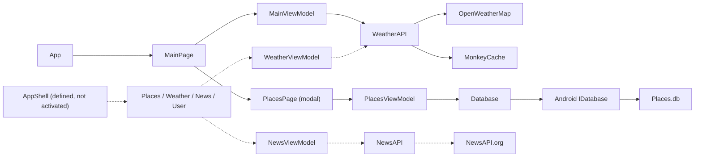
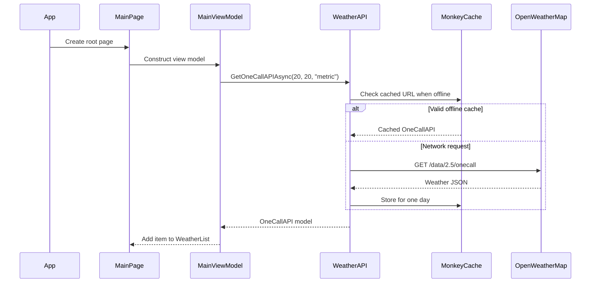

# Weather

A Xamarin.Forms weather client that combines forecast data, local place management,
news, charts, and a custom mobile UI in a shared C# codebase for Android and iOS.

> **Project status — legacy portfolio project.** This repository targets
> Xamarin.Forms 5 and .NET Standard 2.0. Xamarin support ended on May 1, 2024.
> For new development, prefer .NET MAUI or native Kotlin/Swift.

## Overview

The active startup path creates `MainPage`, whose `MainViewModel` loads OpenWeatherMap
One Call data for the fixed coordinates `20, 20`. From that page, users can open a
modal saved-places workflow backed by SQLite on Android.

The repository also contains an `AppShell` with Places, Weather, News, and User tabs,
plus a first-launch onboarding flow. `App.xaml.cs` does not currently make
`AppShell` the root page, so those Shell routes are implemented but are not part of
the active startup experience.

## Implemented Capabilities

- Current, hourly, and daily weather models populated from OpenWeatherMap One Call.
- Five-day/three-hour city forecasts rendered with a Syncfusion chart.
- Saved-place create, read, update, and delete operations over a local SQLite table.
- One-day file caching for weather responses through MonkeyCache.
- Weather-related news retrieval and a `CarouselView` presentation.
- First-launch onboarding, custom fonts, SVG assets, and PancakeView-based layouts.
- Android-specific toast and SQLite dependency implementations.
- An experimental AdMob page configured with Google's documented sample ad units.

## Technology Stack

| Area | Technology |
| --- | --- |
| UI | Xamarin.Forms 5.0.0.2012, XAML, PancakeView |
| Language/runtime | C#, .NET Standard 2.0, Mono/Xamarin |
| Presentation | MVVM-style view models, commands, data binding |
| Networking | `HttpClient`, Newtonsoft.Json, Xamarin.Essentials connectivity |
| Weather | OpenWeatherMap forecast and One Call endpoints |
| News | NewsAPI `/v2/everything` |
| Local data | sqlite-net-pcl, `DependencyService`, MonkeyCache.FileStore |
| Visualization | Syncfusion Xamarin SfChart and SfProgressBar |
| Platforms | Android target framework v10.0 / API 29; iOS deployment target 8.0 |

## Architecture



The solid path is the active application flow. Dashed paths represent components
present in the repository but not reached from the current root page.

### Active Weather Request



## External Services

| Service | Verified use |
| --- | --- |
| OpenWeatherMap | `GET /data/2.5/forecast?q={city}&units=metric` |
| OpenWeatherMap | `GET /data/2.5/onecall?lat={lat}&lon={lon}&units={units}` |
| NewsAPI | `GET /v2/everything?q={city} Weather&from={date}&sortBy=publishedAt` |

The app uses direct client-side API requests. It does not include a backend proxy,
account sign-in, or a geolocation request.

## Navigation and Runtime State

| Component | Current state |
| --- | --- |
| `MainPage` | Active root page |
| `PlacesPage` | Opened modally from `MainPage` |
| `AppShell` tabs | Defined in XAML, but not instantiated by `App` |
| `OnboardingPage` | Triggered only by the inactive `AppShell` constructor |
| `WeatherPage` and `NewsPage` | Implemented; intended for Shell navigation |

## Local Data

`Database` creates one SQLite table, `Places`, with these persisted fields:

| Field | Purpose |
| --- | --- |
| `Id` | Auto-incrementing primary key |
| `CityName` | Display and API query value |
| `CityLat`, `CityLon` | Coordinates stored with the place |
| `CityKey` | Additional city identifier |
| `RegistrationDate` | Creation metadata |

The only `IDatabase` platform implementation in the repository is under
`Weather.Android`. The iOS project does not provide a matching implementation, so
SQLite-backed paths require additional iOS work.

## Project Structure

```text
Weather/
├── Weather/
│   ├── Data/              # SQLite abstraction and repository-style operations
│   ├── Model/             # Weather, news, onboarding, and place models
│   ├── Services/          # OpenWeatherMap and NewsAPI clients
│   ├── View/              # Xamarin.Forms pages
│   ├── ViewModel/         # Commands, state, and data-loading logic
│   ├── App.xaml(.cs)      # Active application startup
│   └── AppShell.xaml(.cs) # Defined Shell and onboarding startup
├── Weather.Android/       # Android host, resources, SQLite, and toast services
└── Weather.iOS/           # iOS host and platform assets
```

## Getting Started

### Prerequisites

- macOS with a Xamarin-capable Visual Studio for Mac/Mono toolchain.
- Xamarin.Android with Android API 29 installed.
- Xcode and Xamarin.iOS for iOS builds.
- NuGet connectivity for restoring the legacy dependency graph.
- OpenWeatherMap and NewsAPI credentials.
- A valid Syncfusion license for the installed Xamarin controls.

Modern Visual Studio releases no longer provide supported Xamarin workloads. A
period-correct toolchain or a migration to .NET MAUI may be necessary.

### Configure Credentials

The previously committed OpenWeatherMap, NewsAPI, and Syncfusion values have been
removed from source. The legacy clients now read these process environment
variables and fail explicitly when a required API key is missing:

- `OPENWEATHERMAP_API_KEY`
- `NEWS_API_KEY`
- `SYNCFUSION_LICENSE_KEY` (optional at startup; required for licensed controls)

Historical values must still be treated as compromised and revoked or rotated in
their provider dashboards. Do not commit replacements. For a maintained app, keep
billable API access behind a backend service and use platform-appropriate
configuration for non-secret values.

### Restore and Build

From the repository root:

```bash
msbuild Weather.sln /t:Restore
msbuild Weather.sln /p:Configuration=Debug
```

Open `Weather.sln` in a Xamarin-capable IDE to select an emulator, simulator, or
device. The commands above exercise the solution-level Debug configuration; device
deployment still requires matching platform SDKs and signing.

### Verification Performed

On July 24, 2026, NuGet restore completed successfully with Mono MSBuild 16.10.1.
The shared project and Android project compiled in the Debug solution build. The
iOS native stage failed under Xcode 26.5 because the retired Xamarin registrar
expects `NewsstandKit/NewsstandKit.h`, which is no longer supplied by the current
SDK. This is a legacy-toolchain compatibility failure; iOS was not runtime-tested.

## Known Limitations

- Xamarin.Forms is retired, and the Android project targets obsolete API level 29.
- The iOS build is incompatible with the current Xcode SDK because the legacy
  Xamarin toolchain references the removed NewsstandKit framework.
- The app starts at `MainPage`; `AppShell`, its tab navigation, and onboarding are
  not activated.
- The dashboard uses fixed coordinates rather than device geolocation or a selected
  saved place.
- SQLite is registered for Android only; iOS local-data flows are incomplete.
- historical API and Syncfusion values require provider-side rotation even though they have been removed from the current source
- News loading assumes a saved place and a minimum response size, with limited
  empty/error-state handling.
- Service clients instantiate `HttpClient` per call and have minimal cancellation,
  retry, and response-error handling.
- Cache initialization is coupled to the One Call request path.
- No automated test project or continuous-integration workflow is present.
- The repository contains no product screenshots or demo recording.

## Modernization Path

1. Revoke the historical credentials and move sensitive service access behind a
   small authenticated backend.
2. Migrate the shared UI and platform hosts to .NET MAUI on a supported .NET
   release.
3. Choose one navigation model, make it the tested root flow, and add empty,
   loading, offline, and error states.
4. Replace `DependencyService` with dependency injection and add an iOS SQLite
   implementation or a cross-platform data service.
5. Introduce typed, reusable HTTP clients, configuration, cancellation, and tests
   around API parsing and persistence.
6. Update Android/iOS targets, third-party packages, and automated build checks.

## Related Articles

These articles by the repository author cover techniques represented in the
codebase:

- [Xamarin.Forms Shell Navigation](https://serkanseker.com/xamarin-forms-shell-gezinti-cubugu/)
- [Install and Manage NuGet Packages](https://serkanseker.com/install-and-manage-nuget-packages/)
- [Material Theme in Xamarin](https://www.serkanseker.com/xamarin-material-theme/)
- [Making a Splash Screen](https://serkanseker.com/xamarin-giris-ekrani/)
- [Creating an Onboarding Screen](https://www.serkanseker.com/tr/xamarin-forms-onboarding-screen/)
- [Using PancakeView in Xamarin](https://serkanseker.com/xamarin-forms-pancakeview-eklentisi-kullanimi/)
- [Using a Weather API in Xamarin](https://www.serkanseker.com/xamarin-using-weather-api/)
- [Using SQLite in Xamarin.Forms](https://serkanseker.com/xamarin-forms-sqlite-kullanimi/)
- [Xamarin.Forms CarouselView](https://www.serkanseker.com/xamarin-forms-carouselview/)

## Author

Created by [Serkan Şeker](https://github.com/srknskr).

## License

No license file is present. Copyright remains with the repository owner unless a
license is added.
